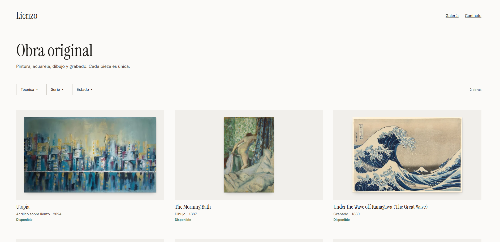
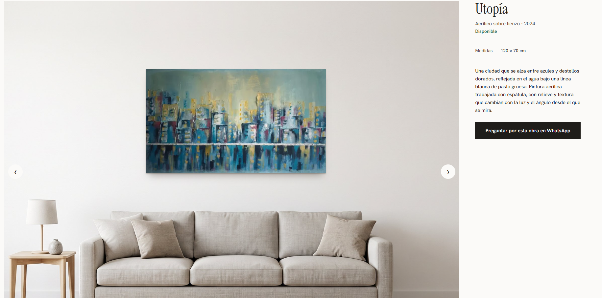
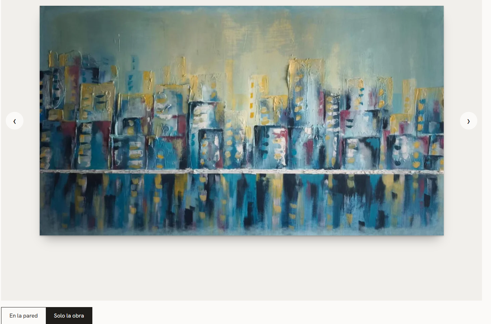
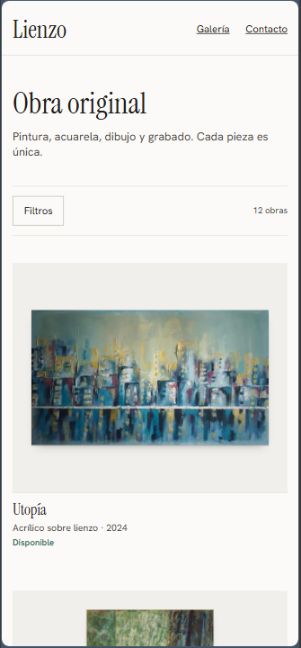
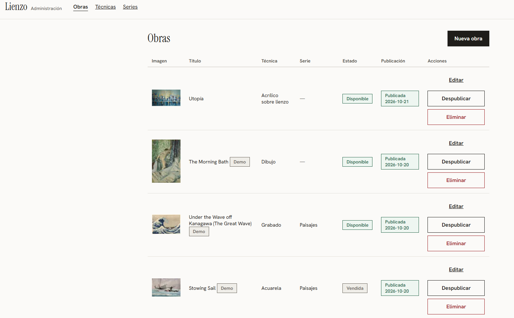
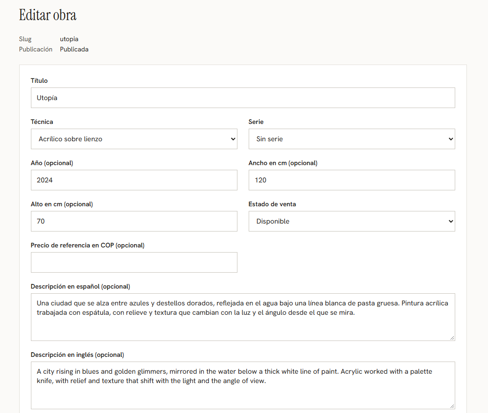
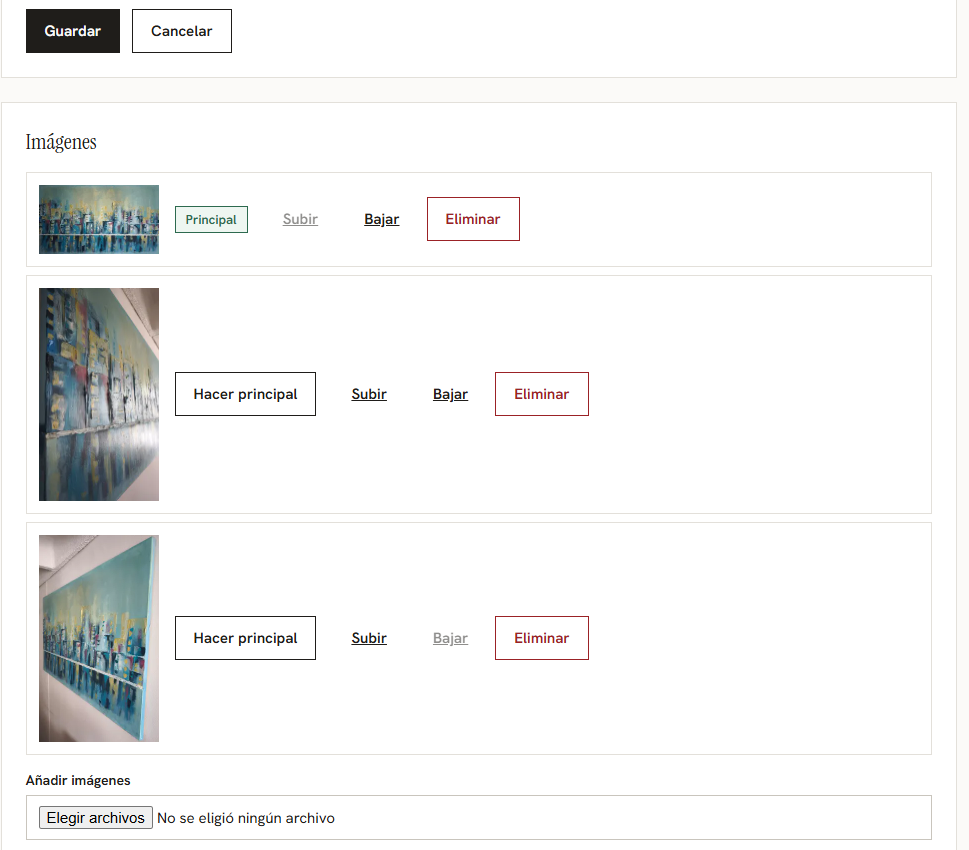
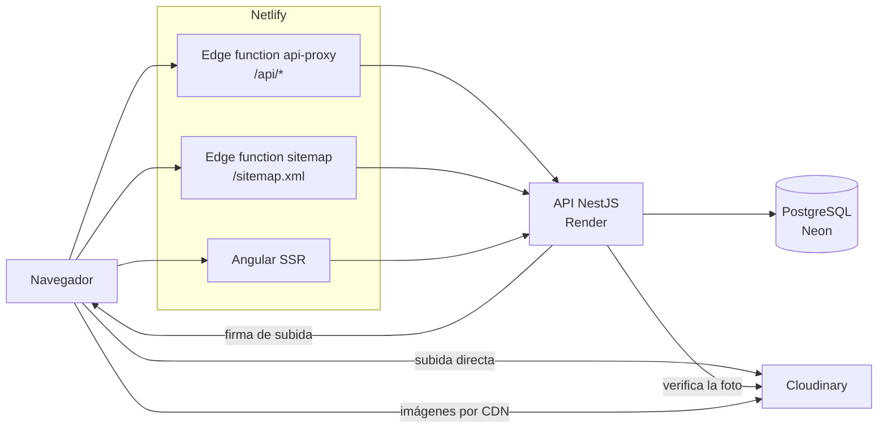

# Lienzo

Galería web de obra original con contacto por WhatsApp y un panel privado para gestionar el catálogo.

Sitio en vivo: <https://lienzo-gallery.netlify.app>

[](https://github.com/Maxito06/lienzo-gallery/actions/workflows/ci.yml)

## Alcance

Lienzo atiende a dos perfiles:

- Visitantes que consultan la obra de un artista. Cada pieza es única y su página muestra el precio de referencia cuando el administrador lo ha cargado. El interés se canaliza por WhatsApp con un mensaje que incluye el título de la obra y el enlace a su página; las obras vendidas no muestran el botón.
- Un administrador que crea, edita, publica y retira obras, y gestiona técnicas, series e imágenes.

El catálogo público de demostración usa obras de dominio público. El catálogo incluye además una obra real cargada desde el panel de administración.

## Funcionalidades

### Sitio público

- Galería en cuadrícula con filtros por técnica, serie y estado, y paginación. Los filtros viven en la URL.
- Detalle de obra con carrusel de fotos (flechas, miniaturas, teclado y gesto de deslizar).
- Vista en pared: la foto principal se monta sobre una sala de referencia a escala real a partir de las medidas en centímetros, con alternancia a "Solo la obra". Si la obra no tiene medidas o no cabe en la escena, solo se muestra la foto. La fotografía de la sala de referencia es una imagen generada con IA.
- Botón de WhatsApp por obra (con título y enlace de la obra en el mensaje), enlace de contacto general y bloque de encargos.
- Aviso de carga lenta cuando la API tarda más de 4 s en responder.
- SEO: renderizado en servidor, URL canónica, `og:url`, datos estructurados JSON-LD `VisualArtwork` (nombre, imagen, técnica, año, medidas y descripción), `robots.txt` y `sitemap.xml`. Las páginas no encontradas llevan `noindex`.
- Accesibilidad: enlace para saltar al contenido, roles y etiquetas en filtros, paginación y visor, y navegación con teclado en el visor.
- Interfaz en español.

### Panel de administración

- Inicio de sesión con límite de intentos; sesión con expiración por inactividad.
- Obras: crear, editar, publicar, despublicar y eliminar (con confirmación en línea). Toda obra nace como borrador y solo se publica con foto principal.
- Estado de venta (disponible, reservada, vendida) y precio de referencia opcional.
- Imágenes: hasta 8 por obra, subida directa a Cloudinary, elección de la principal, reordenamiento y eliminación. Las fotos que superan 10 MB o 25 megapíxeles se reducen en el navegador antes de subir.
- Técnicas y series: alta, edición y borrado.
- Las rutas `admin/**` no se renderizan en el servidor.

## Capturas

Galería:



Detalle de una obra en la vista de pared:



Detalle en el modo "Solo la obra":



Galería en móvil:



Lista de obras del panel de administración:



Formulario de obra del panel de administración, en dos partes:





## Arquitectura



Decisiones relevantes:

- **Mismo origen mediante proxy.** El navegador solo habla con Netlify. La edge function `apps/web/netlify/edge-functions/api-proxy.ts` reenvía `/api/*` a la API quitando el prefijo. La cookie de sesión es del mismo sitio y la API no habilita CORS. Costo: una función más que mantener y que no tiene pruebas automáticas. Se usa una edge function propia porque las redirecciones de `netlify.toml` no se aplican a las páginas SSR.
- **Sesiones en base de datos.** La cookie `__Host-session` (HttpOnly, Secure, SameSite=Strict) lleva un identificador y un secreto aleatorio; en la tabla `admin_session` solo se guarda el SHA-256 del secreto. Las contraseñas usan Argon2id. Expiran a los 30 minutos de inactividad o a las 8 horas. Costo: una consulta a la base de datos por petición autenticada y sesiones vencidas que no se limpian de forma periódica.
- **Protección CSRF.** Además de SameSite=Strict, un guard exige la cabecera `X-Requested-With: lienzo-web` en los métodos que modifican datos; el interceptor de Angular la añade solo a peticiones a `/api/`.
- **Límite de intentos de login en memoria.** 5 fallos por correo en 15 minutos. No usa la IP porque detrás del proxy la API no la conoce de forma fiable. Costo: el contador se reinicia con la API y quien conozca el correo puede bloquear el login 15 minutos.
- **Imágenes en Cloudinary con firma de la API.** El navegador sube directo a Cloudinary con una firma corta emitida por la API, que genera el `public_id`; después la API consulta a Cloudinary y verifica formato, tamaño y dimensiones antes de registrar la foto. Así las imágenes no pasan por Netlify ni por la memoria de Render. Costo: una subida no confirmada deja archivos huérfanos, sin limpieza automática.
- **Capa de lectura pública única.** Todo acceso público a obras pasa por `PublicCatalogService` y su filtro de publicadas. Una prueba de arquitectura falla si otro módulo consulta obras con Prisma. Los borradores y los slugs inexistentes responden igual (404).
- **SSR para SEO.** Las páginas públicas se renderizan en el servidor para que los metadatos y los datos estructurados estén en el HTML inicial. Costo: cada petición depende de la API, y con la API dormida la primera visita es lenta.
- **Sitemap en una edge function.** `sitemap.ts` lee el listado público de la API en lugar de añadir un endpoint nuevo. Si la API falla responde 503. Su generación de XML no tiene pruebas automáticas.

## Tecnologías

Versiones tal como figuran en los `package.json` (rangos de instalación).

| Capa | Tecnología | Versión |
| --- | --- | --- |
| Frontend | Angular (componentes standalone, signals) | ^22.2 |
| Frontend (SSR) | @angular/ssr, Express | ^22.2, ^5.1 |
| API | NestJS | ^12 |
| ORM | Prisma con adaptador `pg` | ^7.10 |
| Base de datos | PostgreSQL en Neon | gestionada |
| Contraseñas | argon2 (Argon2id) | ^0.45 |
| Lenguaje | TypeScript | ^6.0 (API), ~6.0 (web) |
| Pruebas unitarias API | Vitest | ^4.1 |
| Pruebas unitarias web | Vitest con jsdom | ^5.0, jsdom ^30 |
| Pruebas e2e web | Playwright | ^1.64 |
| Imágenes | Cloudinary | servicio externo |
| Entorno de ejecución | Node.js | 24 |
| Fuentes | Instrument Serif, Hanken Grotesk (autohospedadas desde npm) | ^5.3 |

## Pruebas y calidad

| Tipo | Ubicación | Comando |
| --- | --- | --- |
| Unitarias de la API | `apps/api/src/**/*.spec.ts` | `npm run test` en `apps/api` |
| e2e de la API | `apps/api/test/` | `npm run test:e2e` en `apps/api` |
| Unitarias de la web | `apps/web/src/**/*.spec.ts` | `npx ng test --watch=false` en `apps/web` |
| e2e de la web (Playwright) | `apps/web/e2e/` | `npm run e2e` en `apps/web` |

- Las pruebas e2e de la API usan una rama de Neon aparte (`TEST_DATABASE_URL`), que se borra y recrea en cada ejecución. Un control aborta si esa variable apunta a la misma base que `DATABASE_URL` o `DIRECT_URL`. Cloudinary se sustituye por un falso.
- Las pruebas de Playwright solo leen y navegan, sin escribir datos, porque corren contra la API real. Requieren la API y la web en marcha y `npx playwright install chromium` una vez. Las de administración leen `E2E_ADMIN_EMAIL` y `E2E_ADMIN_PASSWORD` y se omiten si faltan.
- El pipeline de CI (`.github/workflows/ci.yml`) se ejecuta en cada push y pull request hacia `main`, con Node 24 y sin secretos. Ejecuta, en paralelo, `npm ci`, compilación y pruebas unitarias de la API, y `npm ci`, pruebas unitarias y compilación de la web. No ejecuta las e2e de la API (requieren la base de pruebas y un secreto) ni Playwright (requiere la API y una base de datos). No despliega.

## Ejecución en local

Requisitos: Node 24 (`.nvmrc`), una base de datos PostgreSQL (Neon u otra) y una cuenta de Cloudinary con un upload preset firmado.

1. Instalar dependencias de cada proyecto (el `postinstall` de la API genera el cliente de Prisma):
   ```
   cd apps/api && npm install
   cd ../web && npm install
   ```
2. Crear `apps/api/.env` a partir de `apps/api/.env.example`. Variables:
   - `DATABASE_URL`: conexión de la API en ejecución (con pooling, si el proveedor lo ofrece).
   - `DIRECT_URL`: conexión directa, usada por Prisma para las migraciones.
   - `TEST_DATABASE_URL`: base de datos de pruebas e2e; debe ser distinta de las anteriores porque las pruebas la borran.
   - `CLOUDINARY_CLOUD_NAME`, `CLOUDINARY_API_KEY`, `CLOUDINARY_API_SECRET`: credenciales de Cloudinary.
   - `CLOUDINARY_UPLOAD_PRESET`: preset de subida firmado.
   - `ADMIN_EMAIL`, `ADMIN_PASSWORD`: cuenta del administrador que crea el seed (la contraseña debe tener al menos 12 caracteres).
3. Aplicar las migraciones desde `apps/api`:
   ```
   npx prisma migrate deploy
   ```
4. Cargar los datos iniciales (opcional): `npm run seed` en `apps/api`. El script compila la API, crea el administrador, las técnicas, las series y las obras de demostración, y **sube sus imágenes a Cloudinary**. Si el administrador ya existe, le restablece la contraseña con `ADMIN_PASSWORD`.
5. Arrancar la API: `npm run start:dev` en `apps/api` (puerto 3000 por defecto, o el de `PORT`).
6. Arrancar la web: `npm start` en `apps/web` (<http://localhost:4200>). El proxy de desarrollo `apps/web/proxy.conf.json` reenvía `/api` a `http://localhost:3000`.

## Despliegue y operación

| Pieza | Plataforma | Despliegue |
| --- | --- | --- |
| Web (Angular SSR y edge functions) | Netlify, base directory `apps/web` | Los builds están detenidos y se reanudan solo al desplegar |
| API | Render (plan gratuito) | Despliegue automático |
| Base de datos | Neon | Gestionada; las migraciones se aplican a mano |
| Imágenes | Cloudinary | Gestionada |

- Netlify usa `API_ORIGIN` (destino de la API) y, opcionalmente, `SITE_URL` (sitemap). Render necesita las variables `CLOUDINARY_*` y las de base de datos.
- `GET /health` responde `200 { "status": "ok" }` sin consultar la base de datos, con `Cache-Control: no-store`. Un monitor externo (UptimeRobot, plan gratuito) consulta <https://lienzo-api.onrender.com/health> cada 5 minutos para mantener la API activa. Si el monitor falla, la API vuelve a dormirse. `GET /health/db` mide la latencia de la base de datos y no debe usarse para el monitor.
- Los errores con estado 5xx se registran en el log de la API como una línea JSON, sin cuerpo, cabeceras, cookies ni datos del usuario.
- Límites del plan gratuito:
  - Render duerme la API tras unos 15 minutos sin tráfico. La primera petición posterior tardó entre 24 s y 33 s en las mediciones. La web muestra un aviso de espera, y el login lanza una llamada previa para despertarla.
  - Cada despliegue a producción en Netlify consume 15 créditos del límite mensual.
  - Cloudinary limita cada imagen a 10 MB y 25 megapíxeles y aplica una cuota mensual de créditos.

## Limitaciones conocidas y trabajo pendiente

- Fuera de alcance: carrito de compra y pago en línea; la venta se concreta por contacto directo.
- Hay un único administrador, creado por el seed. El panel no permite cambiar la contraseña y no hay doble factor.
- La interfaz es solo en español. Los campos en inglés existen en el modelo de datos, pero la web no los usa.
- Los textos de portada y de encargos (`brand.config.ts`) son provisionales.
- Dominio propio pendiente. Al añadirlo hay que cambiar `siteUrl` en `brand.config.ts`, `robots.txt`, `SITE_URL` del sitemap y `security.allowedHosts` en `angular.json`.
- Las pruebas e2e de edición del administrador están pendientes, sobre la rama de pruebas de Neon.
- El CI no ejecuta las e2e de la API ni Playwright. La rama `main` no exige que el CI pase.
- Las migraciones de Prisma no se aplican en el despliegue de Render.
- No se purga la caché de Netlify al publicar, retirar o editar una obra (RF-19), y las rutas públicas no envían cabeceras de caché.
- No hay limpieza de archivos huérfanos en Cloudinary ni de sesiones vencidas.
- El limitador de intentos de login se reinicia con la API.
- El seed firma sus subidas con su propia fórmula, distinta de la de la API; debe revisarse si se vuelve a ejecutar con carpetas dinámicas de Cloudinary.
- La reducción de imágenes en el navegador no tiene prueba automática. La edge function del proxy y la generación del sitemap tampoco.
- Los mensajes de WhatsApp están solo en español.
- Las listas del panel de administración no están paginadas.

## Estructura del repositorio

```
apps/api        API NestJS: módulos admin, auth, public, cloudinary, seed; esquema y migraciones de Prisma
apps/api/test   Pruebas e2e de la API
apps/web        Frontend Angular con SSR
apps/web/netlify  Edge functions (proxy de la API y sitemap)
apps/web/e2e    Pruebas Playwright
docs            Documentación del proyecto
docs/capturas   Capturas usadas en este README
.github         Workflow de integración continua
```

## Documentación

- [Índice de la documentación](docs/README.md)
- [Requerimientos](docs/requerimientos.md)
- [Modelo de datos](docs/modelo-de-datos.md)
- [Arquitectura](docs/arquitectura.md)
- [Registro de decisiones](docs/decisiones/registro.md)
- [Decisiones visuales](docs/diseno/decisiones-visuales.md)

## Autoría y licencia

Proyecto de portafolio de [Maximiliano Correa Pico](https://github.com/Maxito06).

Sin licencia declarada.
