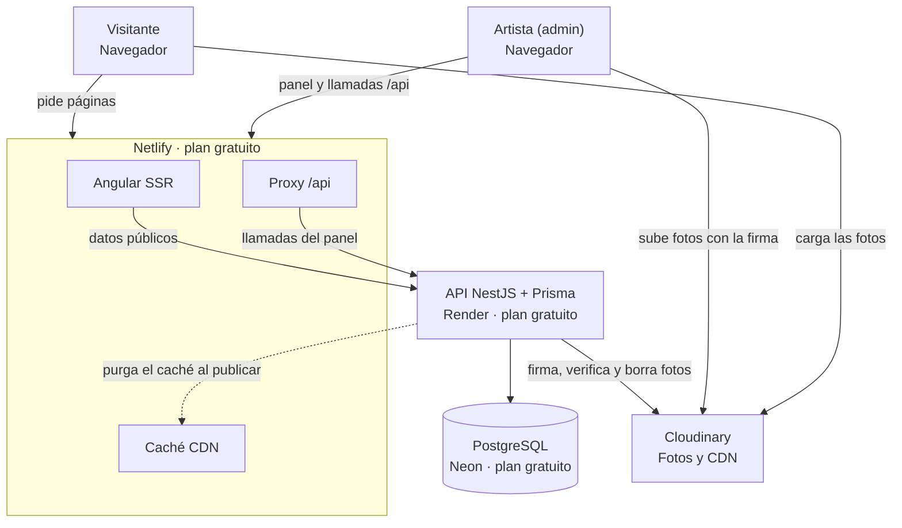
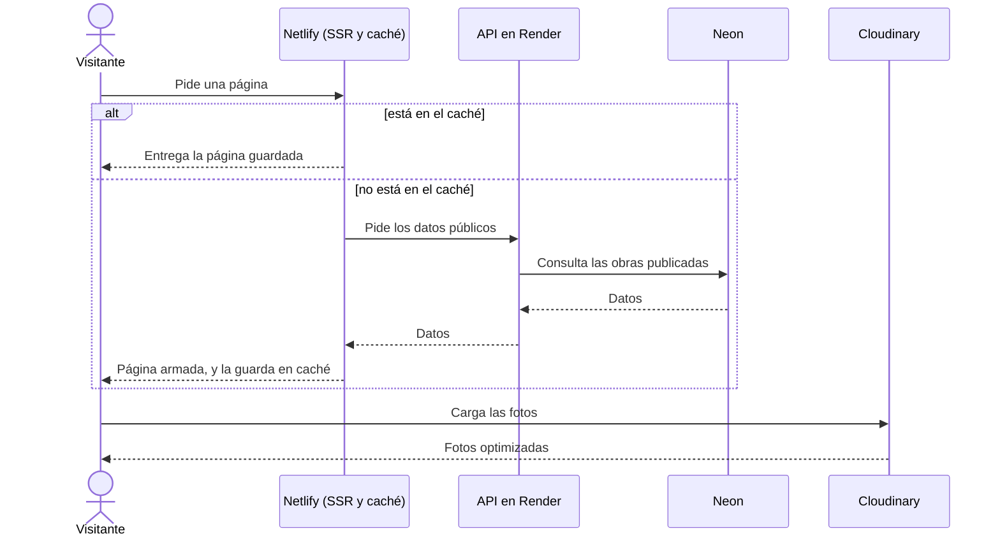
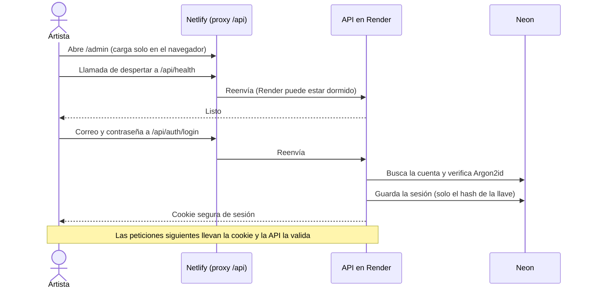
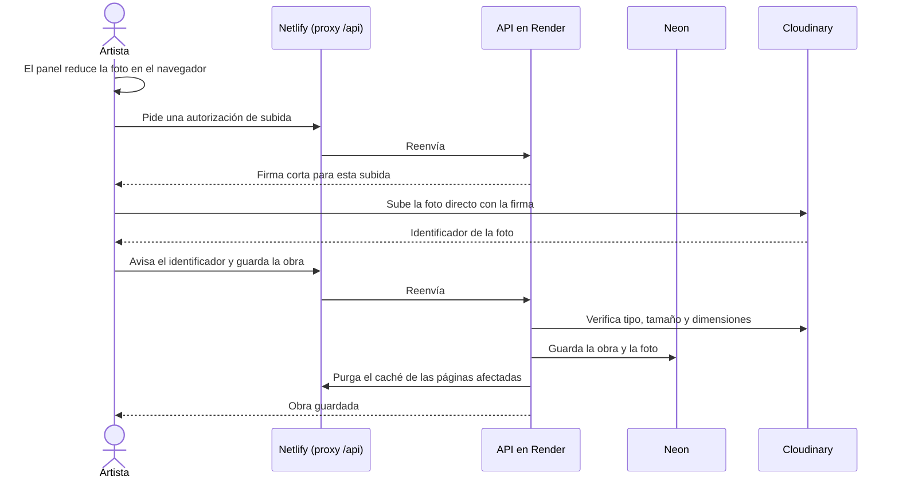

# Lienzo – Arquitectura v1

Oct 16, 2026 · @Max

El visitante y el artista solo hablan con Netlify, salvo las fotos, que van directo a Cloudinary; todo corre en planes gratuitos.

## Mapa general

Netlify sirve las páginas con Angular SSR, las guarda en su caché y reenvía las llamadas de datos a la API en Render. Solo la API habla con la base de datos. Las fotos van directo entre el navegador y Cloudinary; la API solo firma la subida, la verifica y borra.

## Recorridos

### Una visita normal

Si la página está en el caché de la CDN, se entrega al instante; si no, el SSR la arma pidiendo los datos a la API y la guarda en caché.

### El login del artista

El panel carga solo en el navegador y, antes del formulario, despierta la API con una llamada liviana, porque Render puede estar dormido.

### Publicar una obra con fotos

La foto se reduce en el navegador, se sube directo a Cloudinary con una firma corta de la API, y la API la verifica antes de registrarla.

## Qué corre dónde

Todos los datos de límites vienen de las páginas oficiales de cada servicio, consultadas el 2026-10-16.

| Pieza | Qué hace | Dónde corre | Plan | Límite a vigilar |
| --- | --- | --- | --- | --- |
| Angular con SSR | Páginas públicas y panel | Netlify | Gratuito, 300 créditos al mes | Cada despliegue a producción cuesta 15 créditos; al agotarlos se pausan todos los proyectos de la cuenta |
| Caché de páginas | Guarda las páginas ya armadas | CDN de Netlify | Incluido | Hay que configurar las cabeceras y la purga |
| Proxy /api | Reenvía las llamadas del panel a la API | Netlify | Incluido | Corta las peticiones a los 26 segundos |
| API NestJS con Prisma | Datos, login y firma de subidas | Render | Gratuito, 512 MB | Se duerme tras 15 minutos sin tráfico y tarda cerca de un minuto en despertar; 750 horas al mes |
| PostgreSQL | Obras, series, técnicas, cuenta y sesiones | Neon | Gratuito, 1 GB | El cómputo se apaga a los 5 minutos sin uso |
| Fotos | Almacén, optimización y entrega por CDN | Cloudinary | Gratuito, 25 créditos al mes | 10 MB y 25 megapíxeles por foto; verificar qué pasa al agotar los créditos |

## Riesgos y validaciones

La prueba de humo (TEC-13) valida los cinco primeros, y la subida directa de fotos de punta a punta, antes de construir el resto; el plan B de cada uno está pensado de antemano.

| Riesgo | Qué podría pasar | Cómo se valida | Plan B |
| --- | --- | --- | --- |
| Arranque en frío encadenado | La primera visita tras mucho tiempo sin uso tarda más de un minuto | Medir cada pieza y la cadena completa | Caché con vigencia larga; si no basta, un solo servicio en Render con NestJS y SSR juntos |
| Caché de Netlify con Angular SSR | No guarda las páginas o no se purga al publicar | Probar las cabeceras y la purga con una página real | Un solo servicio en Render |
| Cookie de sesión por el proxy | La sesión no se guarda como cookie propia del sitio | Iniciar sesión a través del proxy | Dominio propio con subdominios del mismo sitio, con el costo del dominio |
| Login tras el arranque en frío | El proxy corta a los 26 segundos mientras Render despierta | Llamada de despertar al abrir el login, con reintento y mensaje de espera | Reintento automático en el navegador |
| Memoria de NestJS con Prisma en 512 MB | El servicio se cae por falta de memoria | Medir el uso real | Aligerar la app o cambiar de ORM, que está aislado en una capa |
| Créditos de Cloudinary | Se agotan y el servicio se limita | Revisar el uso y qué ocurre al agotarlos | Cloudflare R2 |
| Fotos subidas y nunca confirmadas | Ocupan espacio sin pertenecer a ninguna obra | Etiquetarlas al subir y limpiarlas | Mecanismo de limpieza por definir en la fase 3 |
| Cambios en los planes gratuitos | Un servicio cambia sus límites | Revisar los planes antes de desplegar | Cada servicio está aislado en una sola capa del código |

Las decisiones que sustentan esta arquitectura están registradas en el documento *Lienzo – Requerimientos v1*, sección Decisiones.
