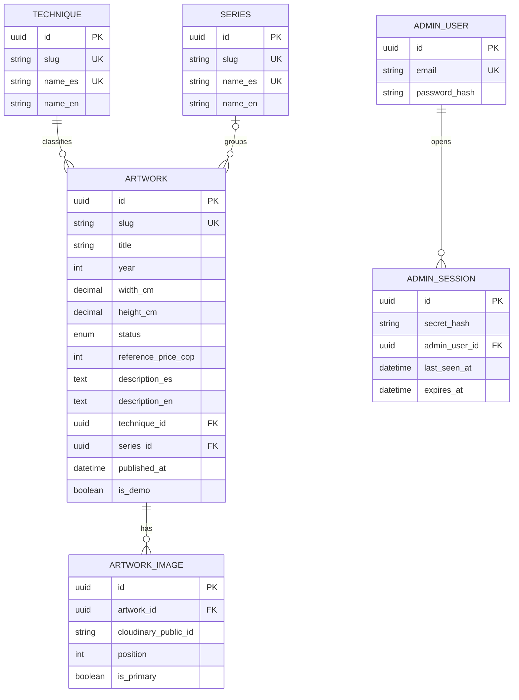

# Lienzo – Modelo de datos v1

Oct 16, 2026 · @Max

Lienzo guarda sus datos en 6 tablas de PostgreSQL; el español es el idioma principal y el inglés el alternativo, en columnas dentro de cada tabla.

## Diagrama

Obras, imágenes, técnica y serie por un lado; la cuenta del administrador y sus sesiones por otro. Los textos en español e inglés son columnas dentro de cada tabla.

## Tablas y campos

Los nombres de tablas y campos van en inglés, como el resto del código.

### artwork: la obra

| Campo | Tipo | Nota |
| --- | --- | --- |
| id | uuid | Clave primaria |
| slug | text | Único; da la URL legible y no cambia al editar el título |
| title | text | Título original; no se traduce |
| year | integer | Opcional |
| width\_cm, height\_cm | numeric(6,1) | Opcionales; medidas en centímetros |
| status | enum | AVAILABLE, RESERVED o SOLD; por defecto AVAILABLE |
| reference\_price\_cop | integer | Opcional; pesos colombianos; se muestra solo si está lleno y la obra no está vendida |
| description\_es | text | Opcional; descripción en español |
| description\_en | text | Opcional; si falta se muestra la de español |
| technique\_id | uuid | Obligatorio; apunta a technique |
| series\_id | uuid | Opcional; apunta a series |
| published\_at | timestamp | Opcional; vacío significa borrador y solo lo ve el admin; al publicar se guarda la fecha y hora |
| is\_demo | boolean | Marca las obras de demostración; por defecto falso |
| created\_at, updated\_at | timestamp | Fecha de creación y de última edición |

### artwork\_image: las fotos de una obra

| Campo | Tipo | Nota |
| --- | --- | --- |
| id | uuid | Clave primaria |
| artwork\_id | uuid | Obligatorio; apunta a artwork |
| cloudinary\_public\_id | text | Identificador de la imagen en Cloudinary, no la dirección completa |
| position | integer | Orden de las fotos dentro de la obra; el carrusel las muestra en ese orden |
| is\_primary | boolean | Una sola foto principal por obra; es la que se muestra en la grilla y abre el carrusel |
| created\_at | timestamp | Fecha de subida |

### technique y series: las listas que gestiona el admin

Ambas tablas tienen la misma forma.

| Campo | Tipo | Nota |
| --- | --- | --- |
| id | uuid | Clave primaria |
| slug | text | Único |
| name\_es | text | Obligatorio y único; nombre en español |
| name\_en | text | Opcional; si falta se muestra el de español |

### admin\_user: la cuenta del artista

| Campo | Tipo | Nota |
| --- | --- | --- |
| id | uuid | Clave primaria |
| email | text | Único |
| password\_hash | text | Hash Argon2id; nunca la contraseña |
| created\_at | timestamp | Fecha de creación; la cuenta la crea el seed |

### admin\_session: las sesiones abiertas

| Campo | Tipo | Nota |
| --- | --- | --- |
| id | uuid | Identificador público de búsqueda; viaja en la cookie junto con la llave secreta |
| secret\_hash | text | Hash SHA-256 de la llave secreta; la llave nunca se guarda |
| admin\_user\_id | uuid | Obligatorio; apunta a admin\_user |
| created\_at | timestamp | Fecha de inicio de sesión |
| last\_seen\_at | timestamp | Última actividad; sirve para el límite de 30 minutos de inactividad |
| expires\_at | timestamp | Vencimiento absoluto: 8 horas después de iniciar sesión |

## Relaciones y reglas de borrado

Cada relación define qué pasa cuando se borra el registro del lado "uno".

| Relación | Qué pasa al borrar |
| --- | --- |
| technique → artwork (una técnica, muchas obras) | Se bloquea mientras la técnica tenga obras |
| series → artwork (una serie, muchas obras; la serie es opcional) | Las obras quedan sin serie |
| artwork → artwork\_image (una obra, muchas fotos) | Se borran las fotos de la base de datos; el código también las elimina de Cloudinary |
| admin\_user → admin\_session (un admin, muchas sesiones) | Se borran sus sesiones |

Otras garantías de la base de datos: el slug es único en obras, técnicas y series; el nombre en español es único en técnicas y series; y cada obra tiene una sola foto principal, garantizada con un índice único parcial que se escribe en la migración.

## Idiomas

Lienzo tiene dos idiomas y no se contemplan más: el español es el principal y el inglés el alternativo. Cada texto traducible es una columna por idioma dentro de su propia tabla.

| Qué se traduce | Dónde vive | Si falta el inglés |
| --- | --- | --- |
| Descripción de la obra (opcional) | artwork.description\_es y description\_en | Se muestra la de español; si no hay descripción, no se muestra ese bloque |
| Nombre de la técnica | technique.name\_es y name\_en | Se muestra el de español |
| Nombre de la serie | series.name\_es y name\_en | Se muestra el de español |

No se traducen el título de la obra, el año ni las medidas. La interfaz del panel de administración queda solo en español. El español es obligatorio en técnicas y series, y el inglés siempre es opcional.

## Decisiones de diseño

- **Identificadores:** UUID en todas las tablas, para que no se puedan adivinar ni recorrer en orden.
- **URLs:** cada obra tiene un slug único. No cambia al editar el título, para no romper enlaces ya compartidos ni el posicionamiento en buscadores.
- **Precio:** número entero en pesos colombianos, opcional (DEC-06). Las obras vendidas no lo muestran.
- **Medidas:** decimales en centímetros, opcionales.
- **Estado:** lista cerrada de tres valores; las obras vendidas siguen visibles.
- **Imágenes:** se guarda el identificador de Cloudinary, no la dirección completa, para poder cambiar de proveedor (DEC-03). Máximo de 8 fotos por obra, validado en el panel y en la API para cuidar los créditos de Cloudinary. La foto se sube directo del navegador a Cloudinary con una firma de la API, y la API la verifica antes de registrarla en artwork\_image.
- **Sesiones:** se guarda solo el hash de la llave secreta y los tiempos de inactividad y vencimiento (DEC-05).
- **Obras de demostración:** el campo is\_demo permite borrar de una vez las de demostración cuando lleguen las reales.
- **Borradores simples:** una obra con published\_at vacío es un borrador y solo la ve el admin; al publicarla se guarda la fecha. Toda lectura pública pasa por una sola capa que filtra por obras publicadas, y las pruebas comprueban que un borrador nunca aparece en la galería, el detalle, los filtros ni el mapa del sitio. Las fotos de un borrador están en Cloudinary con direcciones difíciles de adivinar pero no secretas, así que un borrador no es confidencial.
- **Capa de acceso:** Prisma queda aislado en una sola capa de NestJS (DEC-02).

**Fuera de v1:** más de dos idiomas, publicación automática en una fecha programada, varias monedas y varios administradores.
